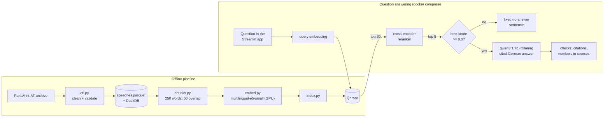
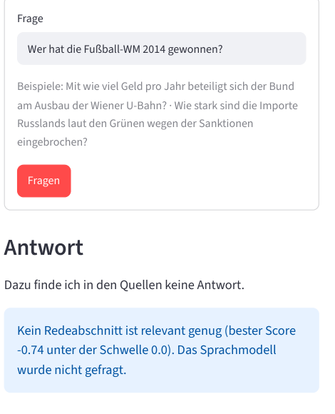

# ParlaMint-AT RAG: asking questions about Austrian parliamentary speeches

A small retrieval-augmented generation (RAG) system over the speeches of the Austrian
National Council (Nationalrat), 2018 to 2022. You ask a question in German, and the system
finds the relevant speech passages. A local language model then writes a short answer
that cites its sources. Everything runs on your own machine: no external API.

This project complements a university deep learning assignment. In that assignment I
fine-tuned a Qwen model with LoRA to predict a speaker's party from the same corpus. Here I
wanted to build a RAG system end to end and learn where it fails in practice. That means
measuring it, not only demonstrating it.


## What it does

- **ETL with data-quality checks**: 17,276 speeches, 9.0 million words, cleaned and validated.
- **Chunking**: 46,254 overlapping chunks of about 250 words, each with speaker, party and date.
- **Two-stage retrieval**:
  1. Vector search in Qdrant with `multilingual-e5-small`.
  2. A multilingual cross-encoder re-sorts the top 30 hits.
  3. Optional filters by party and year.
- **Relevance gate**: if no passage is relevant enough, the system says so and does not ask the language model.
- **Generation**: `qwen3:1.7b` via Ollama writes a German answer with a numbered citation per sentence.
- **Automatic checks**, shown as warnings in the app:
  - citations missing or invalid
  - sentences without a source
  - numbers that do not appear in the cited source
- **Evaluation**:
  - 25 German questions with gold speech ids
  - retrieval metrics
  - answers rated against the source texts
- **Packaging**: Docker Compose with three containers (Qdrant, Ollama, Streamlit app).

## Architecture



## Results

### Evaluation set

The evaluation set has 25 German questions written from real speeches:
- 12 fact questions
- 5 questions with a party or year filter
- 3 questions about a named speaker
- 5 questions the corpus cannot answer

Every answerable question has one or more gold speech ids. They were found by searching the
whole corpus for the same fact. Several of the unanswerable questions are deliberately hard:
- the topic is in the corpus, but the asked fact is not ("AI rules for schools decided in 2023")
- the fact is general knowledge, but not in the speeches ("Who won the 2014 World Cup?")

### Retrieval (20 answerable questions)

A hit means at least one gold speech is among the top k chunks.

| | Recall@1 | Recall@5 | Recall@10 | MRR@10 |
|---|---|---|---|---|
| Vector search only | 0.50 | 0.75 | 0.80 | 0.58 |
| + cross-encoder reranker | **0.75** | **0.90** | **0.90** | **0.82** |

- **Gain**: the reranker found two of the four questions that vector search missed.
- **Cost**: about 8 s per query on two CPU cores, small next to the 100 s or more the language model needs.
- **Still missed**: two questions.
  - One asks about a named speaker. The name is stored as metadata, not in the chunk text, so neither model can match it.
  - The other uses different words from the speech.

### Answers (qwen3:1.7b, 25 questions)

Each answer was rated against the source texts:
- **faithful**: every factual claim (number, date, person, event) is supported by the sources.
- **correct**: the answer states the reference fact. For an unanswerable question, it does not invent an answer.

| | Baseline | Stricter prompt | Reranker | Reranker + gate |
|---|---|---|---|---|
| Gold speech among the sources | 0.75 | 0.75 | 0.90 | 0.90 |
| Answerable: correct (n=20) | 0.55 | 0.45 | **0.80** | **0.80** |
| Answerable: faithful | 0.53 | 0.45 | 0.53 | 0.56 |
| Unanswerable: correct (n=5) | 0.60 | **0.80** | 0.40 | 0.60 |
| Answers that mix text with the no-answer sentence | 0.20 | 0.52 | 0.16 | 0.12 |
| Seconds per answer (2 CPU cores) | 98 | 134 | 114 | 114, blocked ones ~8 |

Notes on the table:
- Faithfulness is rated only for answers with content (n = 19, 20, 19, 18).
- The gate column is simulated from the rated reranker answers ([eval/results/gate_rerank.csv](eval/results/gate_rerank.csv)):
  - above the threshold, the model sees the same sources, so its rated answer stays valid
  - below the threshold, the system returns the no-answer sentence

### What I learned from the numbers

1. **Better retrieval helped most.** The reranker raised answer correctness from 0.55 to 0.80.
   Changing the prompt did not help:
   - The stricter prompt told the model to give only the no-answer sentence when unsure. It made the model refuse more unanswerable questions.
   - It also cost two correct answers to answerable ones.
   - The small model never returned the bare sentence. I measured this variant and rejected it.
2. **Faithfulness is a model problem.** Even with the right source, `qwen3:1.7b` often adds a wrong year, cites the wrong source number or invents a detail. The core fact is usually right.
3. **Better retrieval can make abstention worse.** The reranker also finds the closest near-misses for unanswerable questions. Example: a passage saying that the *next* World Cup takes place in Qatar. The small model then built an answer from it ("Qatar won the 2014 World Cup").
4. **The relevance gate is a cheap fix, but it has limits.**
   - A threshold of 0.0 on the best reranker score blocks two unanswerable questions and one answerable question whose answer was wrong anyway.
   - It blocks no correct answer, and it saves the 100 s model call.
   - The hard negatives score as high as real answers (0.9 to 2.1 against 1.6 for an answerable question), so no threshold separates them.
   - The threshold was chosen on the same 25 questions it is evaluated on, so the result is optimistic.
5. **Automatic checks flag, they do not fix.**
   - The number check flags 11 of the 29 unfaithful answers across all runs, and only 1 of the 29 faithful ones.
   - It cannot see claims in words, or correct numbers used in the wrong context.
   - The uncited-sentence warning is a weaker signal: the model often writes summary sentences without a citation.



## Running it

The pipeline has three stages, each on suitable hardware:

| Stage | Where I ran it | Why |
|---|---|---|
| ETL and chunking | laptop | pandas on about 60 MB of text |
| Embeddings | Google Colab (T4 GPU) | 46k chunks take 7 minutes on a GPU |
| Qdrant, Ollama, app, evaluation | GitHub Codespaces (2 cores, 8 GB RAM, 32 GB disk) | Docker is preinstalled |

### 1. Data and chunks

```bash
python -m venv .venv && source .venv/bin/activate
pip install -r requirements.txt
python -m parlamint_rag.etl       # downloads ~330 MB, writes data/processed/speeches.parquet
python -m parlamint_rag.chunks    # writes data/processed/chunks.parquet
```

Run these from the repository root with `src` on the Python path (`pip install -e . --no-deps`
or `export PYTHONPATH=src`).

### 2. Embeddings

Open [notebooks/colab_runner.ipynb](notebooks/colab_runner.ipynb) in Colab with a GPU runtime.
It clones the repository, runs the ETL, chunking and `embed.py`, and copies
`embeddings.parquet` to Google Drive. Put the file into `data/processed/`.

### 3. Start the stack

```bash
docker compose up -d --build
docker compose exec ollama ollama pull qwen3:1.7b               # once, ~1.4 GB
docker compose run --rm app python -m parlamint_rag.index       # once, loads 46k vectors
```

Open http://localhost:8501 (in Codespaces: the forwarded port 8501). The first question
takes longer, because the embedding model and the reranker are downloaded once into a volume.

These settings are environment variables:

| Variable | Default | Meaning |
|---|---|---|
| `LLM_MODEL` | `qwen3:1.7b` | Ollama model |
| `RERANK_MODEL` | `cross-encoder/mmarco-mMiniLMv2-L12-H384-v1` | empty = vector search only |
| `RELEVANCE_THRESHOLD` | `0.0` | empty = no relevance gate |

### 4. Evaluate

```bash
# retrieval only (minutes) or retrieval + answers (about 50 minutes on 2 CPU cores)
docker compose run --rm -v "$PWD/eval:/app/eval" app python -m parlamint_rag.evaluate --retrieval-only --tag rerank
docker compose run --rm -v "$PWD/eval:/app/eval" app python -m parlamint_rag.evaluate --tag rerank
# after rating the answers by hand (columns faithful, correct)
python -m parlamint_rag.evaluate --summarize eval/results/answers_qwen3-1.7b_rerank.csv
# best reranker score per question and the simulated relevance gate
docker compose run --rm -v "$PWD/eval:/app/eval" app python -m parlamint_rag.evaluate --gate eval/results/answers_qwen3-1.7b_rerank.csv --tag rerank
```

### Practical notes

- **Disk**: the Ollama image alone takes 8.5 GB on disk (it ships GPU libraries), and the app image plus its build cache need several GB more. On a 32 GB Codespace, run `docker builder prune -af` after a build.
  - Because of this, Compose mounts `src/` and `app/` into the app container, so code changes need a restart (`docker compose up -d`), not a rebuild.
- **Ollama crashes**: on two cores the Ollama runner crashed about 3 times in 25 answers. `evaluate.py` saves after every answer, retries, and can `--resume`.

## Project layout

```
src/parlamint_rag/
  config.py     paths, model names, thresholds (environment variables for Docker)
  etl.py        download, extract, clean, validate, store (Parquet + DuckDB)
  chunks.py     overlapping word windows with speech metadata
  embed.py      E5 embeddings with "query: " / "passage: " prefixes
  index.py      Qdrant collection, payload indexes, filtered search, sanity checks
  rerank.py     cross-encoder second stage
  rag.py        retrieve -> relevance gate -> prompt -> cited answer
  verify.py     citation and number checks
  evaluate.py   Recall@k, MRR, answer metrics, relevance gate simulation
app/streamlit_app.py
eval/questions.jsonl, eval/results/    evaluation set and all result files
notebooks/colab_runner.ipynb           thin GPU runner, no logic in the notebook
Dockerfile, docker-compose.yml
```

## Design decisions

- **Chunks of 250 words with 50 words of overlap.**
  - About 70 % of the speeches are longer than the 512-token limit of the embedding model, so embedding whole speeches would cut them off.
  - With 250 words, a median chunk has 369 tokens, and only 0.02 % of chunks are truncated.
  - The overlap keeps facts at the window borders.
- **E5 prefixes.** `multilingual-e5-small` was trained with `query: ` and `passage: ` prefixes. Without them, retrieval quality drops. The vectors are normalised, so cosine similarity equals the dot product.
- **Retrieve and rerank.**
  - A bi-encoder embeds question and passage separately: fast, works on the whole corpus.
  - A cross-encoder reads both together: more accurate, but too slow for 46k chunks.
  - So the bi-encoder proposes 30 candidates and the cross-encoder picks the best 5.
- **Prompt design.**
  - The sources are numbered, and the rules are repeated after the sources ("sandwich" prompt), because a small model forgets system rules after about 2,000 tokens of context.
  - A rule tells the model to treat the sources as data, not instructions, as a basic defence against prompt injection.
  - `think=False` and a temperature of 0.1 keep the answers short and stable.
- **Small local model on purpose.** `qwen3:1.7b` runs on two CPU cores. It makes the failure modes of RAG easy to see, and the whole stack stays on own infrastructure.

## Limitations

- **Small evaluation set.** 25 questions and one rater: differences of one or two questions are not significant. The numbers show tendencies.
- **Ambiguous reference.** One fact question turned out to be ambiguous: two speeches give different figures (60 vs 68 million euro). Both count as correct.
- **Speaker names are not searchable.** Speaker names are metadata, not part of the chunk text, so "What did X say about Y" retrieves passages about Y by anyone.
- **Salutations add noise.** Most first chunks start with a salutation ("Sehr geehrter Herr Präsident!"). I measured it at about 4 % of a chunk and did not strip it.
- **Wrong details.** The 1.7B model often gets the main fact right and a detail wrong. The app warns, but cannot correct.
- **Speed.** One answer takes about two minutes on a CPU. This is a prototype, not a service.
- **Colab is Google infrastructure.** Using it for embeddings is fine for public parliamentary data in a prototype. In production, the embedding step would also run on own hardware.

## Next steps

These are the next steps I would take in a larger setting, roughly in order of expected effect:

1. **Larger evaluation set** (100+ questions, two raters). Then an LLM-as-judge that is validated against the human ratings, and run as a regression test in CI.
2. **Larger language model** on own GPU hardware (for example `qwen3:4b` or `8b`). This is the most direct lever for faithfulness.
3. **Hybrid search**: BM25 or sparse vectors combined with dense vectors (reciprocal rank fusion). This helps with exact terms, numbers and names.
4. **Metadata in the chunk text or a self-query filter**, so questions about named speakers work.
5. **Claim verification** with an NLI model, or a "quote first, then answer" prompt, to catch wrong details beyond numbers.
6. **A larger embedding model** (`multilingual-e5-large`, `bge-m3`), and parent-document retrieval for more context.
7. **Operations**: monitoring, user feedback buttons, versioned prompts and indexes.

## Data protection, sovereignty and the EU AI Act

- **No external API.** Questions, sources and answers stay on the machine:
  - Qdrant and Ollama run in local containers.
  - Their ports are bound to `127.0.0.1`.
  - Telemetry is switched off for Qdrant, Streamlit and the Hugging Face client.
- **Pinned versions.** Container images and Python packages are pinned, so the system can be rebuilt as it was evaluated.
- **Personal data.** The speeches are public and contain the names of members of parliament. That is the purpose of the corpus. Questions typed into the app are not stored.
- **EU AI Act.**
  - The app tells users that the answer is AI-generated and may be wrong.
  - It shows the sources next to every answer and marks unverified claims, so a human can check them.
  - A system like this answers information questions and makes no decisions about people, so it would most likely fall under the transparency obligations, not the high-risk category.

## Lessons learned from the earlier assignment

Reviewing my own assignment code before reusing the corpus taught me more than the assignment itself:

- **Import data defensively.**
  - Read the TSV files with `quoting=csv.QUOTE_NONE` (quotes are part of speeches).
  - The metadata rows end with a tab, so pandas needs `index_col=False`.
  - Assert unique ids after a merge (`validate="one_to_one"`).
  - Print the row count after every cleaning step. In the assignment, a party filter right before `drop_duplicates` made 862 removed rows look like duplicates; they were actually ministers without a party.
- **Keep the case of German text.** Lowercasing destroys information in German (nouns, names). The ETL keeps the original text.
- **Check the evaluation code, not only the model.**
  - A reused variable meant that the "historical" test set was really part of the training data (leakage).
  - Prefix matching of labels ("Centre" vs "Centre-left") made every prediction the same class.
  - The baseline was an untrained classification head. A fair baseline is the majority class.

  None of these show up as errors, only as suspicious numbers. This is why this project measures every change against a fixed evaluation set.

## Data and licence

Data: ParlaMint-AT, part of *Erjavec, Tomaž et al. (2024). Multilingual comparable corpora of
parliamentary debates ParlaMint 4.1.* CLARIN.SI, http://hdl.handle.net/11356/1912, licensed
under [CC BY 4.0](https://creativecommons.org/licenses/by/4.0/). The data is downloaded by
`etl.py` and is not part of this repository.

Models:
- [intfloat/multilingual-e5-small](https://huggingface.co/intfloat/multilingual-e5-small)
- [cross-encoder/mmarco-mMiniLMv2-L12-H384-v1](https://huggingface.co/cross-encoder/mmarco-mMiniLMv2-L12-H384-v1)
- [Qwen3 1.7B](https://ollama.com/library/qwen3) via Ollama
